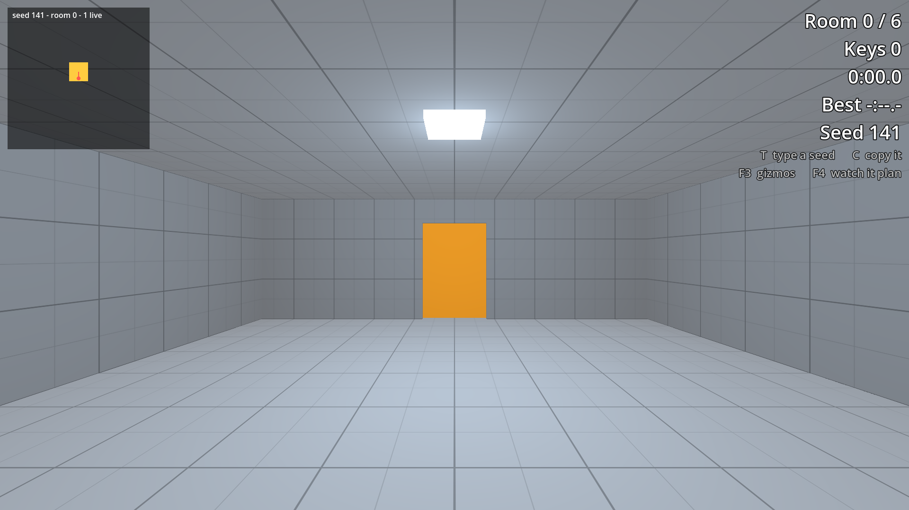

# Light and Atmosphere in Godot 4

Project files for tutorial 09 of the Godot 4 series by Phaix on YouTube (https://www.youtube.com/@Phaix).

Light a Godot 4.7 run whose rooms are built while the game plays. A lamp for every room, set from data: the plan's tint, the energy and the shadows of the room type, and a range worked out from the room. A warm exit light on every door, proven by a squint test that blurs the picture and measures the door against the wall. An environment made for closed interiors: no sky and no sun, a low warm fill that stays dark and never black, AgX tonemapping and glow above white. Volumetric fog that the lamps light without hiding the door, with its density taken from a test. Global illumination for rooms that do not exist in the editor: a script asks the engine which kinds can bake, and frame times measured on one machine decide between VoxelGI and SDFGI (LightmapGI is out). A quality switch on the Q key that keeps the expensive parts inside the frame budget. Every step is its own project folder.



## Steps

Every step of the video is its own folder in `steps/`, the exact state at the end of that
part. Open the project in Godot 4.7, then open `steps/<step>/main.tscn` and press F6 to run
that step. The project's main scene is the final step.

| Folder | Part of the video |
|---|---|
| `steps/step_00_start` | Starting point (the final state of the previous tutorial) |
| `steps/step_01_room_lights` | Step 1 - Room lights from data |
| `steps/step_02_world_environment` | Step 2 - An environment for interiors |
| `steps/step_03_volumetric_fog` | Step 3 - Volumetric fog |
| `steps/step_04_runtime_gi` | Step 4 - Global illumination for runtime rooms |
| `steps/step_05_quality_switch` | Step 5 - A quality switch |

## Controls

WASD or arrow keys or the left stick to walk, mouse or right stick to look, Space to jump,
Esc gives the mouse back, a click captures it again. Further keys per tutorial are shown
in the video and in the HUD.

## Tests

```sh
godot --headless --path . -s res://tests/run_tests.gd
```

## License

Code and scenes: MIT (see LICENSE).
